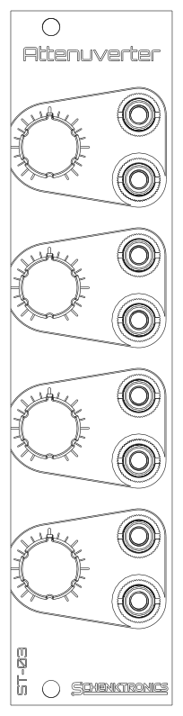

<picture>
  <source media="(prefers-color-scheme: dark)" srcset="docs/images/logo-light.png">
  
</picture>

# ST-03 Attenuverter

A 6HP Eurorack quad attenuverter from **Schenktronics**. Each of its four channels scales a signal anywhere from x1, through zero, to x-1 (inverted). Every input is normalled to +5 V, so with nothing plugged in, each channel is a manual offset from -5 V to +5 V.



## Features

- 6HP, 20 mm deep. 16 mA on +12 V and 9 mA on -12 V.
- Four channels, each turning a signal down, off, or inverting it
- Knobs with a printed zero mark at the top of their travel
- Inputs normalled to +5 V: four manual offset voltages when nothing's plugged in
- Reverse-power protection on both rails
- Kits come with the surface-mount parts already soldered and tested: 54 through-hole joints to build

## Documentation

| Document | For | PDF |
|----------|-----|-----|
| [User Manual](docs/manual.md) | Using the module | [PDF](docs/pdf/ST-03_Attenuverter_User_Manual.pdf) |
| [Assembly Guide](docs/assembly-guide.md) | Building the kit | [PDF](docs/pdf/ST-03_Attenuverter_Assembly_Guide.pdf) |
| [Bill of Materials](docs/BOM.md) ([CSV](docs/BOM.csv)) | Parts and sourcing | |

## Repository layout

```
hardware/
  ST-03_Attenuverter.step          3D model of the assembled module
  attenuverter/                    Main PCB (KiCad 10)
    Attenuverter.kicad_sch           Schematic
    Attenuverter.kicad_pcb           PCB layout
    Attenuverter.step                3D model
    attenuverter BOM.xlsx            Original BOM spreadsheet
  panel/                           Faceplate (KiCad 10, made as an aluminum PCB)
    AttenuverterFaceplate.kicad_pcb  Faceplate layout
    AttenuverterFaceplate.step       3D model
docs/                              Manual, assembly guide, BOM, images
  pdf/                               PDF versions of the manual and assembly guide
```

The `.github/` folder holds the automation that builds the PDFs. You can ignore it.

## Fabrication

| Board | Size | Layers | Thickness | Notes |
|-------|------|--------|-----------|-------|
| Main PCB | 30 x 100 mm | 2 | 1.6 mm | Standard green is fine. Surface-mount parts on the back. |
| Faceplate | 30 x 128.5 mm | 1 | 1.6 mm | Aluminum PCB, white solder mask, black silkscreen. Only the front copper layer is used, so FR4 works too. |

## Sourcing your own parts

The [BOM](docs/BOM.md) lists every part, including the surface-mount ones the kits ship with already soldered. The jack pads are oval so the board can also take panel-mount style jacks, which may be easier to source. The CUI MJ-3507 is one example: its sleeve is a solder lug rather than a pin, so each one needs a short wire from that lug to the jack's square pad.

## License

This hardware design and its documentation are licensed under [CC BY-NC-SA 4.0](https://creativecommons.org/licenses/by-nc-sa/4.0/). See [LICENSE](LICENSE).

The Schenktronics name and logo are trademarks of Schenktronics LLC and are not covered by the CC BY-NC-SA 4.0 license.

## Links

- Shop: <https://schenktronics.com/product/st-03/>
- Docs page: <https://schenktronics.com/docs/st-03/>
- Website: <https://schenktronics.com>
