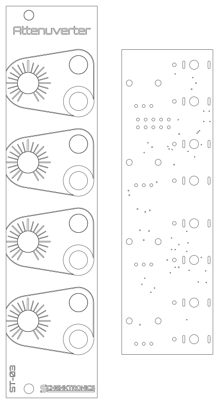
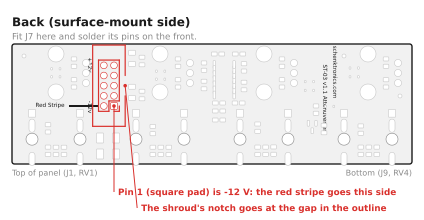
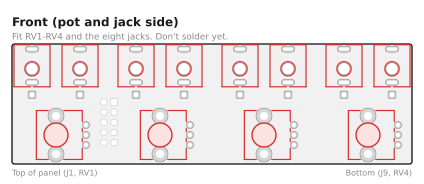
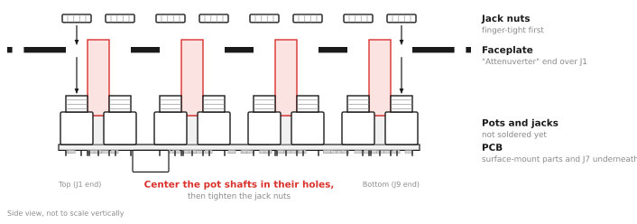
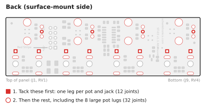
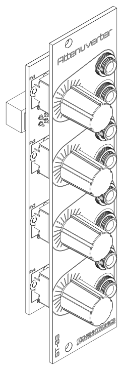

# ST-03 Attenuverter: Assembly Guide

The board in this kit comes with all the surface-mount parts already soldered by the board house and tested by me, so you only solder the through-hole parts: the power header, the jacks, and the pots. That's 54 solder joints and about 45-60 minutes.

**Prefer to watch?** There's a video of the whole build: [Watch me build a surface mount attenuverter!](https://www.youtube.com/watch?v=QJxtZVHBpq0) It starts with the surface-mount parts, which your board already has, so skip ahead.

## What you need

### Kit contents

Check your kit against this list before you start (full details in the [BOM](BOM.md)):

- [ ] 1 x main PCB, with the surface-mount parts already soldered
- [ ] 1 x faceplate
- [ ] 1 x 10-pin shrouded power header
- [ ] 8 x 3.5 mm jacks with nuts
- [ ] 4 x potentiometers
- [ ] 4 x knobs
- [ ] 1 x power cable, 10-pin to 16-pin

### Tools

- Soldering iron (about 330-360 °C for leaded solder, a little hotter for lead-free)
- Solder: 0.8 mm, flux-core
- Safety glasses, since solder can spit
- Multimeter with continuity (beep), diode test, and DC voltage modes
- Small pliers (optional, for squaring up the jacks)
- Nut driver or wrench for the jack nuts (optional, but less likely to scratch the panel than pliers)

## Before you start

- The board has two sides. The **back** has the surface-mount parts, and it's printed "ST-03 v1.1 / Attenuverter", "schenktronics.com", "Red Stripe", and "-12v" and "+12v" by the power header. The **front** has the outlines for the pots and jacks (RV1-RV4, J1-J6, J8, and J9).
- Build in this order: the power header first, then the pots and jacks. The header is easier to reach before anything else is in the way.
- **Don't solder the pots or jacks until the faceplate is on.** The faceplate holds them in line while you solder.

### First time soldering?

You only need the basics for this kit:

- Touch the iron to the pad and the pin at the same time, then feed solder into the joint, not onto the iron tip. A second or two is usually enough.
- A good joint is shiny and shaped like a small cone around the pin. A dull, lumpy blob usually means the pad didn't get hot enough. Reheat it, use some flux, and add a touch more solder if necessary.
- Keep the tip clean and lightly tinned. Wipe it on a damp sponge or brass wool between joints.
- Remember that solder flows toward the heat.
- Leaded solder (63/37 or 60/40 tin/lead) is easier to learn with than lead-free: it melts at a lower temperature and flows more easily. Lead-free works fine too, with a slightly hotter iron. Use whichever you prefer.
- If you use leaded solder, wash your hands when you're done, and don't eat, drink, or smoke while you're soldering. Wipe down your work surface afterward, and keep solder away from kids.
- Solder somewhere with some airflow, and keep your face to the side of the fumes, not right above them. The fumes primarily come from the flux, not the metals in the solder, but they can irritate your lungs.

## Step 1: Fit the power header

1. Push J7 into its holes from the **back**. Turn it so the notch in the shroud lines up with the gap in the printed outline. Pin 1 (the square pad) is -12 V, next to the "Red Stripe" marking.
2. Turn the board over and solder one pin on the front. Check that the header sits flat against the board. If it doesn't, reheat the pin and press it down.
3. Solder the other nine pins.

## Step 2: Check for shorts

Before you add anything else, check the power rails with a multimeter in diode test mode (the diode symbol). No power is needed. Probe the header pins from the front of the board.

Use diode test mode, not resistance mode. Most meters test resistance at too low a voltage to turn a diode on, so a protection diode fitted backwards reads as an open circuit in resistance mode and looks fine. Diode test mode uses a higher voltage and shows the diode's forward voltage instead.

| Test | Expected result |
|------|-----------------|
| Red probe on pin 9 (+12 V), black on pin 3 (ground) | OL, or a high reading. It may count up for a moment while the capacitors charge. |
| Red probe on pin 3 (ground), black on pin 1 (-12 V) | OL, or a high reading. It may count up for a moment. |
| Red probe on pin 3 (ground), black on pin 9 (+12 V) | About 0.5-0.7 V: D1 conducting |
| Red probe on pin 1 (-12 V), black on pin 3 (ground) | About 0.5-0.7 V: D2 conducting |
| Red probe on pin 9 (+12 V), black on pin 1 (-12 V) | OL |

A reading near 0 V (many meters also beep) means a short. The surface-mount side was tested before it shipped, so look for a solder bridge between the header pins you just soldered. If the header looks clean and a reading is still wrong, [get in touch](https://schenktronics.com/contact/) before you power it up.

## Step 3: Fit the pots and jacks

1. Push the four pots into RV1-RV4 from the **front** of the PCB. Each pot only fits one way round: the three pins go in the row of three small holes, and the two mounting lugs go in the large holes. The lugs clip into the board and hold the pot in place.
2. Push the eight jacks into J1-J6, J8, and J9 from the front. Make sure each one sits flat with all three legs through their holes.
3. Don't solder anything yet.

## Step 4: Fit the faceplate

1. Take the nuts off the jacks and set them aside. The pots have no nuts.
2. Lower the faceplate over the parts. The "Attenuverter" label goes at the top, over J1 and RV1, and the pot shafts go through the four bigger holes.
3. Rubber bands or small spring clips can be helpful to hold the faceplate and the board together while you work.
4. Put the jack nuts back on and hand-tighten them for now.
5. Use a small pair of pliers to rotate the jack bodies as necessary to align them squarely with each other. This step is optional, but a nice touch.
6. Check that each pot shaft is centered in its hole, and that the PCB is parallel to the faceplate. The shafts are thinner than their holes, and only the solder will hold them, so centering them now stops the knobs rubbing later. The legs have a little play in their holes, which gives you room to adjust.

## Step 5: Solder the pots and jacks

Turn the whole thing over and solder from the back of the PCB, between the surface-mount parts.

1. Tack one leg of each part: the square pad of each jack, and the middle pin of each pot. Then check again that the pot shafts are still centered. If one isn't, reheat that joint and adjust.
2. Solder the remaining pins and pads.
3. Solder the eight large mounting-lug pads of the pots. They connect to ground, so they take a little longer to heat. Hold the iron on until the solder flows into the hole.
4. Snug the nuts down. Don't overtighten: it can strip the jack threads or damage the panel.

> **Using panel-mount style jacks?** The oval pads also take jacks like the CUI MJ-3507. Their tip and switch pins go into the board, but the sleeve is a solder lug on the jack, not a pin. Tack the tip pin instead of the square pad, then solder a short wire from each jack's sleeve lug to its square pad. Without the wire, the jack has no ground.

Look over every joint before moving on. Each should be shiny and cone-shaped, with no solder bridging neighboring pads.

## Step 6: Fit the knobs

Push each knob onto its pot shaft. The flat on the shaft sets the knob's position. Each pointer should point straight up, at the long mark on the panel, when the pot is at its center. Check that each knob turns without rubbing on the panel.

## Step 7: Test

### Without power

Repeat the Step 2 short test on the header pins. Then plug a patch cable into each jack in turn, and check its sleeve against a ground pin (pins 3-8) on the header: every jack should beep.

### With power

Connect the module to your case (see [Install](#step-8-install)), with the red stripe on -12 V at both ends, and power on. If anything gets hot or smells, power off at once and check the power cable.

With nothing plugged into the inputs, measure each output with the multimeter on DC volts. Plug a patch cable into the output and probe its tip and sleeve.

| Knob | Expected output |
|------|-----------------|
| Fully clockwise | About +5 V |
| Pointer at the long mark (center) | About 0 V |
| Fully counterclockwise | About -5 V |

Then patch an LFO or another moving signal into each input in turn, and listen or watch as you turn the knob from one end to the other. The signal should shrink to nothing at the center, and grow again, inverted, on the other side.

## Step 8: Install

Mount the module in your case with the included power cable and two M3 rack screws. The details, and how to use the module, are in the [User Manual](manual.md#installation).

## Troubleshooting

| Symptom | Likely cause |
|---------|--------------|
| Nothing works, and the power supply struggles or a fuse trips | The power cable is plugged in backwards, or there's a solder bridge on the power header. |
| No channel works, but nothing gets hot | The power header isn't soldered well. Reflow its ten pins. |
| One channel is dead | A bad joint on that channel's jacks or pot. Reflow them. |
| An empty input works, but a plugged-in signal doesn't come through | A bad joint on that input jack's tip leg. |
| A knob works backwards (clockwise inverts) | The pot is a different type from the one in the BOM. |
| The output isn't quite 0 V with the pointer centered | A small offset is normal. |
| A knob rubs on the panel | The shaft isn't centered in its hole, or the knob is pushed on too far. |
| Something else, or a fault on the surface-mount side | [Get in touch](https://schenktronics.com/contact/). The surface-mount parts were tested before your kit shipped. |
